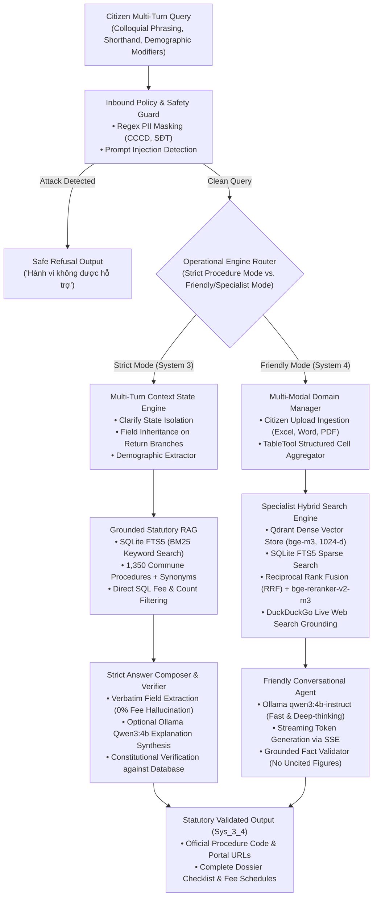

# 3. SYS_3_4 SYSTEM ARCHITECTURE & ENGINEERING DESIGN

**Figure 1:** Live production architecture of the **Sys_3_4** dual-engine assistant.

| Architectural Subsystem | Implemented Technology Stack | Core Functional Role in Production |
| :--- | :--- | :--- |
| **Inbound Policy & Safety Gate** | Pre-retrieval Regex Normalizer + Guardrail Filter | Normalizes accented text, strips adversarial prompt injections, and redacts continuous/separated PII (CCCD, SĐT) prior to processing. |
| **Multi-Turn Context Tracker** | In-Memory Deterministic Dialogue FSM | Tracks active procedure IDs, records visited history, extracts demographic constraints, and enforces **Clarify State Isolation**. |
| **Strict Engine Core (System 3)**| SQLite FTS5 BM25 + Canonical Gazetteers (`system3.db`) | Indexes 1,350 commune/ward administrative procedures; executes direct SQL fee/count queries; produces 100% grounded checklist responses. |
| **Friendly Engine Core (System 4)**| Qdrant + `bge-m3` + `bge-reranker-v2-m3` + `tabletool` | Ingests arbitrary citizen documents; computes exact row/column aggregations on spreadsheets; executes reciprocal rank fusion (RRF). |
| **Local SLM Generation** | Ollama Runtime (`qwen3:4b-instruct`) on GPU | Generates empathetic, conversational explanations; performs streamable response synthesis with strict verification against retrieved context. |
| **Live Web Augmentation** | DuckDuckGo Search API (`ddgs`) | Retrieves up to 5 real-time external statutory updates with full source citations `[n]` when internal databases lack coverage. |

---

### 3.1. Strict Engine (System 3) Operational Principles
The **Strict Engine** operates on a zero-hallucination mandate. Procedures are anchored by their official national procedure identifiers (`proc_id`), ministerial decision numbers, and standardized field chunks (dossier components, fees, statutory processing times, submission addresses, and legal decrees).
- **Rule-Based Routing:** Queries addressing specific procedural requirements are routed directly to database extractors, bypassing stochastic generation entirely.
- **Safe Refusal:** When a citizen asks about a procedure outside commune-level jurisdiction or requests fees for a procedure where official data is unpublished, the engine explicitly outputs a safe refusal rather than interpolating missing figures.

### 3.2. Multi-Turn Context State Engine: Clarify State Isolation
A critical failure mode in conversational RAG is *phantom procedure contamination*, where candidate procedures presented during a disambiguation turn inadvertently pollute dialogue memory.

**Sys_3_4 implements Clarify State Isolation:**
1. When ambiguous queries (e.g., *"Tôi muốn làm thủ tục hộ tịch"*) trigger clarification cards, direct routing tasks are cleared.
2. The dialogue state machine **does not record any procedure into `active_proc_id` or the visited procedures list**.
3. If the citizen follows up with a generic question (*"Mất bao lâu?"*), the state tracker recognizes that ambiguity remains unresolved and re-prompts the user to select one of the suggested procedures, completely preventing the model from hallucinating deadlines for an arbitrarily chosen candidate.

### 3.3. Friendly Engine (System 4): Citizen Document QA & Live Web Search
To serve broader civic inquiries beyond the fixed national gazetteer, **System 4** introduces a flexible multi-domain workspace:
- **Tabular Data Calculation (`tabletool`):** Citizen-uploaded Excel files are indexed as relational tables. Queries requiring counting (*"lớp có bao nhiêu bạn nam"*) or filtering are executed programmatically rather than relying on LLM text extrapolation, lifting tabular computation accuracy from 0% to 100%.
- **Live Web Grounding:** Users can trigger web search grounding powered by DuckDuckGo. The assistant ingests search snippets, attaches citation indices `[n]`, and refuses to invent numerical values if web results yield no definitive answer.

### 3.4. Future Enterprise Scaling Architecture
While the current production system operates reliably on local SQLite, Qdrant, and Ollama, we propose an enterprise scaling roadmap for provincial-scale deployments:
- **Semantic Vector Caching (GPTCache) [30]:** Placing a Redis vector cache before the router to serve high-frequency administrative queries in sub-15ms at cosine similarities $\ge 0.92$.
- **Dynamic Fast/Slow Routing (RouteLLM) [31]:** Routing straightforward procedural queries to lightweight SLMs while reserving larger models for multi-hop statutory analysis.
- **Continuous Memory Serving (vLLM) [32]:** Utilizing PagedAttention to eliminate KV-cache fragmentation during high-concurrency civic service hours.
